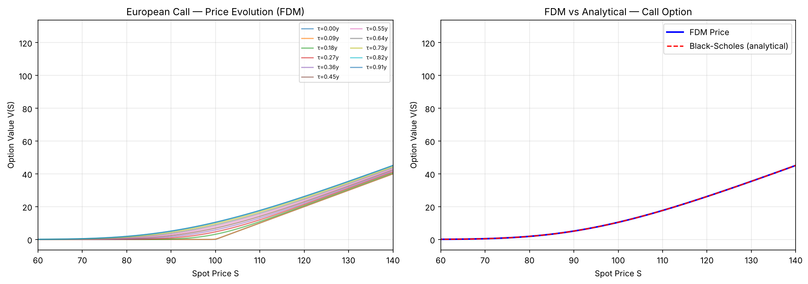
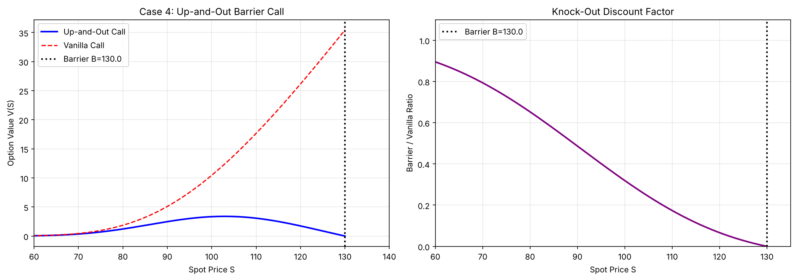
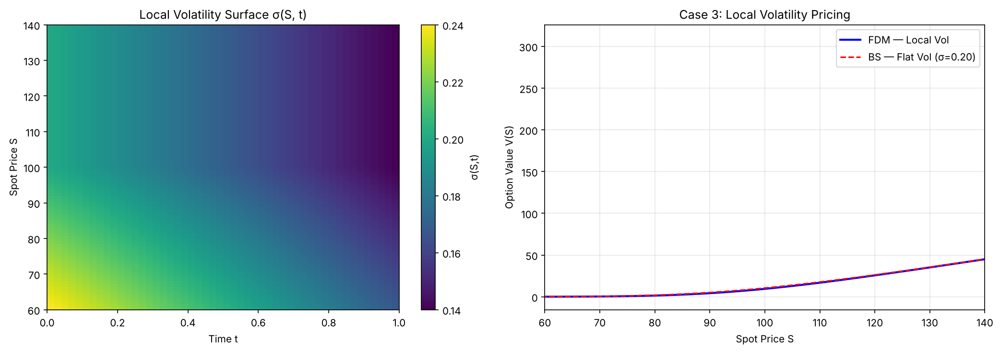
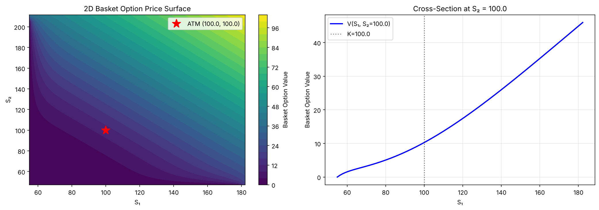
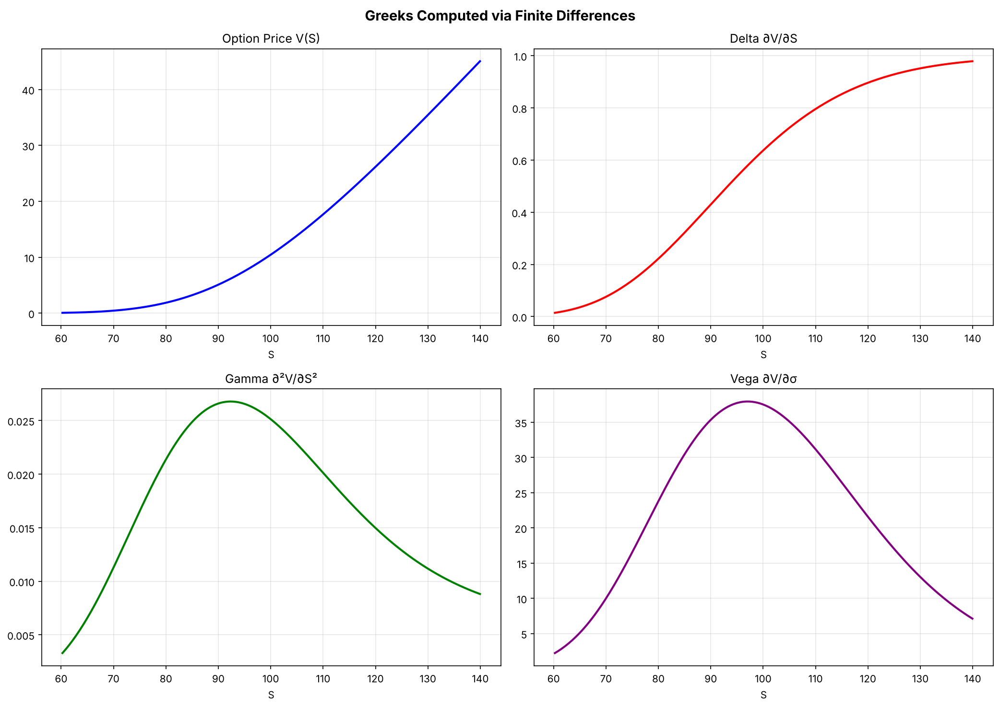
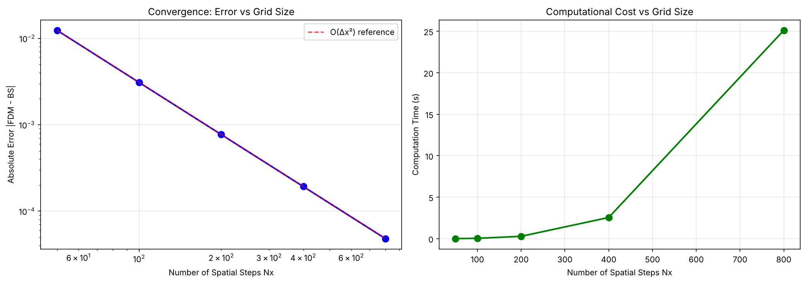

# Option Pricing via Finite Differences
### From Terzaghi's soil consolidation to the Black-Scholes PDE

Ce projet prolonge un projet de géotechnique réalisé à l'**ESTP Paris** (consolidation des sols 1D/2D par l'équation de Terzaghi et différences finies explicites). Après le changement de variable `x = ln(S)`, l'EDP de Black-Scholes devient une équation de convection-diffusion **structurellement identique** à l'équation de la chaleur / de consolidation. Le même solveur numérique est donc adapté au pricing d'options.

📄 **Rapport complet :** [report_soil_consolidation_option_pricing.pdf](report_soil_consolidation_option_pricing.pdf)

## Équation résolue

$$\frac{\partial V}{\partial t} + \tfrac12\sigma^2 S^2 \frac{\partial^2 V}{\partial S^2} + rS\frac{\partial V}{\partial S} - rV = 0$$

Schéma explicite en log-prix, condition de stabilité `β = σ²Δτ / (2Δx²) ≤ 0.5`.

## Cas étudiés

| # | Cas | Analogie géotechnique | Prix (S₀=K=100, T=1, r=5%) |
|---|---|---|---|
| 1 | Call / Put européen, σ constante | Sol homogène, Cv constant | Call **10.4498** (BS : 10.4506) · Put **5.5726** (BS : 5.5735) |
| 2 | Volatilité dépendante du temps (0.30 → 0.15) | Cv variable dans le temps | 11.5434 |
| 3 | Surface de volatilité locale σ(S, t) | Sol hétérogène multicouche | 9.4432 |
| 4 | Up-and-Out Call (barrière B = 130) | Changement brutal des conditions aux limites | 3.3415 |
| 5 | Basket call 2 actifs (EDP 2D, ρ = 0.5) | Consolidation 2D avec drains verticaux | 10.2753 |

Plus : calcul des **Greeks** (Delta, Gamma, Vega) et **analyse de convergence**.

## Résultats

| Comparaison FDM vs Black-Scholes | Option barrière |
|---|---|
|  |  |

| Volatilité locale | Basket option 2D |
|---|---|
|  |  |



### Convergence — ordre O(Δx²) vérifié

| Nx | Nt | Erreur absolue vs BS |
|---|---|---|
| 50 | 98 | 1.24e-2 |
| 100 | 391 | 3.09e-3 |
| 200 | 1 563 | 7.71e-4 |
| 400 | 6 251 | 1.93e-4 |
| 800 | 25 001 | 4.8e-5 |

L'erreur est divisée par 4 à chaque doublement de la grille.



## Lancer le code

```bash
pip install -r requirements.txt
python option_pricing_fdm.py
```

Durée d'exécution : environ 1 minute (la grille Nx = 800 de l'analyse de convergence est la plus coûteuse).

## Auteur

**Alexandre Magnan** —

